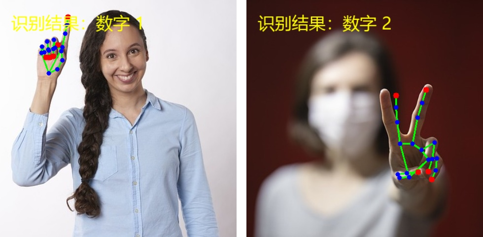

# 实时手势识别（Python + OpenCV + MediaPipe）

基于 **OpenCV** 与 **MediaPipe HandLandmarker** 的实时手势识别小项目：
调用电脑摄像头读取视频流，检测手部 **21 个关键点** 并绘制骨架连线，
根据张开的手指数量实时识别 **0~5 数字手势**，结果直接显示在视频窗口上。

## 功能特性

- 摄像头实时视频流读取，支持 DirectShow 等多后端自动尝试
- 检测手部 21 个关键点，绘制关键点与骨架连线（指尖红色、关节蓝色、骨架绿色）
- 通过手指张开数量识别 0~5 数字手势
- 视频窗口实时显示中文识别结果
- 完善的容错处理：摄像头被占用 / 读帧失败 / 模型缺失自动下载
- 支持同时识别 2 只手
- 附带自测脚本 `self_test.py`，不依赖画面窗口即可检查环境是否就绪

## 效果演示

静态图片自测效果（`assets/demo_result.jpg`）：



运行时窗口左上角会显示操作提示，每只手的手腕附近会显示识别出的数字。

## 运行环境

- Windows / macOS / Linux（开发与测试环境为 Windows）
- Python 3.9 ~ 3.13
- 一个可用的摄像头

## 快速开始

### 方式一：Windows 一键运行（最简单，推荐新手）

双击项目目录下的 **`run.bat`**：

- 第一次运行会自动创建独立虚拟环境 `.venv` 并安装全部依赖（使用国内镜像）；
- 之后再双击会直接启动手势识别程序。

想先检查环境可以双击 **`self_test.bat`** 运行自测。

### 方式二：手动命令行

#### 1. 安装依赖

```bash
pip install -r requirements.txt
```

等价于以下三条命令：

```bash
pip install opencv-python
pip install mediapipe
pip install pillow
```

> 国内网络较慢时可使用国内镜像加速：
> ```bash
> pip install -r requirements.txt -i https://mirrors.huaweicloud.com/repository/pypi/simple
> ```

> 提示：为避免影响 Anaconda / 系统中的其它 Python 环境，推荐使用虚拟环境：
> ```bash
> python -m venv .venv
> .venv\Scripts\activate      # Windows
> pip install -r requirements.txt
> ```

说明：

- `opencv-python`：摄像头采集、图像处理、窗口显示
- `mediapipe`：手部 21 个关键点检测（本项目使用官方 **Tasks API**，mediapipe 0.10.9 及以上版本均支持；1.x 版本同样可用）
- `pillow`：在画面上绘制中文文字（OpenCV 自带的 `putText` 不支持中文）

### 2. （可选）运行自测

```bash
python self_test.py
```

自测会依次检查：依赖库导入、模型加载、0~5 手指计数逻辑、
静态图片端到端推理、摄像头能否打开。全部通过后会显示
`全部检查通过，可以运行：python main.py`。

### 3. 运行主程序

```bash
python main.py
```

把手举到摄像头前，**握拳 = 0，伸出几根手指 = 数字几**，按下键盘 **`q`** 键退出。

若使用外接摄像头，可指定编号：

```bash
python main.py --camera 1
```

其它参数：

```bash
python main.py --max-frames 100        # 处理 100 帧后自动退出（便于自动化测试）
python main.py --snapshot assets/snapshot.jpg  # 无界面保存一帧带标注画面后退出
```

## 手势对照表

| 手势 | 含义 | 判定方式 |
| --- | --- | --- |
| 握拳 | 数字 0 | 五根手指全部弯曲 |
| 伸出 1 根手指 | 数字 1 | 通常为食指伸直 |
| 伸出 2 根手指 | 数字 2 | 食指 + 中指 |
| 伸出 3 根手指 | 数字 3 | 食指 + 中指 + 无名指 |
| 伸出 4 根手指 | 数字 4 | 四根手指伸直、拇指弯曲 |
| 张开手掌 | 数字 5 | 五根手指全部伸直 |

> 识别时建议：**手掌正对摄像头、指尖朝上**，手部与背景对比清晰，
> 识别效果最稳定。

## 模型文件说明

程序使用 MediaPipe 官方 HandLandmarker 模型 `models/hand_landmarker.task`（约 7.8MB）。
仓库已内置该模型文件，无需额外下载；若文件缺失，程序会自动从官方地址下载：

```
https://storage.googleapis.com/mediapipe-models/hand_landmarker/hand_landmarker/float16/1/hand_landmarker.task
```

如下载失败（网络原因），可手动访问该地址，下载后放入项目的 `models/` 目录，
文件名保持为 `hand_landmarker.task`。

## 项目结构

```
python手势识别/
├── run.bat                  # Windows 一键运行（自动建环境、装依赖、启动）
├── self_test.bat            # Windows 一键自测
├── main.py                  # 主程序：摄像头采集、检测、绘制、显示
├── self_test.py             # 自测脚本：环境、模型、逻辑、摄像头检查
├── requirements.txt         # pip 依赖列表
├── models/
│   └── hand_landmarker.task # MediaPipe 手部关键点模型
├── assets/
│   ├── test_hands.jpg       # 自测用静态图片（MediaPipe 官方示例）
│   └── demo_result.jpg      # 静态图片识别效果图（README 展示用）
├── .gitignore
└── README.md
```

## 实现原理

1. **视频采集**：OpenCV `VideoCapture` 读取摄像头帧，水平镜像后得到“自拍视角”。
2. **手部检测**：`HandLandmarker`（VIDEO 模式）逐帧推理，输出最多 2 只手、
   每只手 21 个关键点（归一化坐标）。
3. **骨架绘制**：按官方 `HAND_CONNECTIONS` 连接关系用 `cv2.line` 画连线，
   用 `cv2.circle` 画 21 个关键点。
4. **手指计数**：
   - 食指、中指、无名指、小指：指尖（TIP）的 y 坐标小于对应 PIP 关节的 y 坐标，
     即判定为伸直；
   - 拇指：根据左右手标签比较拇指尖与 IP 关节的 x 坐标；
   - 伸直的手指总数即为识别结果（0~5）。
5. **中文显示**：借助 Pillow 在画面上绘制中文，再转回 OpenCV 图像显示。

关键点编号（MediaPipe 21 点定义）：

```
0  手腕
1~4   拇指（CMC-MCP-IP-TIP）
5~8   食指（MCP-PIP-DIP-TIP）
9~12  中指
13~16 无名指
17~20 小指
```

## 常见问题

**Q1：提示“无法打开摄像头”？**

1. 检查摄像头是否被微信、腾讯会议、浏览器等程序占用，关闭后重试；
2. 检查系统“隐私设置”中是否允许应用访问摄像头；
3. 外接摄像头可尝试 `python main.py --camera 1`。

**Q2：`import mediapipe` 报错，或安装失败？**

请确认 Python 版本为 3.9~3.13；Python 3.13 环境建议使用 mediapipe 1.x，
Python 3.9 环境会自动安装 0.10.x。安装失败时可换用国内镜像源。

**Q3：识别数字不稳定 / 不识别？**

- 尽量让手掌正对摄像头、指尖朝上，手部离镜头不要太近；
- 光线充足，手部与背景颜色区分明显；
- 动作放慢，等待一两帧稳定后再读数。

**Q4：模型报“Unable to open file”？**

项目路径中包含中文时，部分 OpenCV / MediaPipe 版本的 C++ 底层无法读取文件，
本程序已通过“字节流加载模型”和“`np.fromfile` 读写图片”规避该问题。
若仍遇到，请避免将项目移动到过深或含特殊字符的路径下。

## 许可证

- 代码部分：MIT License（可自由学习、修改与使用）
- 模型文件 `hand_landmarker.task` 与 `assets/test_hands.jpg` 来自
  [Google MediaPipe 官方示例](https://ai.google.dev/edge/mediapipe/solutions/vision/hand_landmarker)，
  版权归原作者所有，遵循 Apache-2.0 许可协议，仅用于学习演示。
